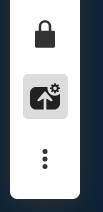
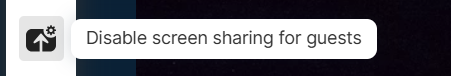
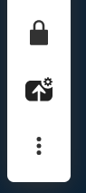
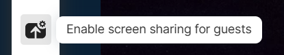
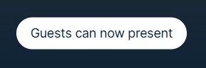
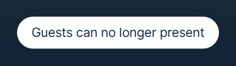

# Web App 3 Plugin: Guests can present

From v38 Pexip Infinity has server-side capability to control whether or not guests
are allowed to start screen-sharing.

This plugin adds the ability for a host participant to control this
functionality.

## How to use

An additional icon is added to toolbar.

- **Enable screen sharing for guests**: Guests are allowed to start screen sharing in a meeting
- **Disable screen sharing for guests**: Guests are not allowed to start screen sharing in the meeting

The icon reflects the state, if the is allowed to present the icon is marked as active.









If the state is changed, a notification shows up for hosts.






The plugin relies on the generic API request: `plugin.conference.sendRequest`. This function is not typed in published plugin-api package.

## Limitations

The plugin only works for transcoded meetings, it will not show up in direct media calls or before Infinity V38.

If there is a running presentation, the screen sharing will not be released by the state change.
This maybe change in future versions of Infinity.

## Run for development

- To be able to build the plugin, you need to comply with the following versions
  or higher:

  | NodeJS   | NPM     |
  | -------- | ------- |
  | v20.12.2 | v10.5.0 |

- Install all the dependencies:

```bash
$ npm i
```

- Run the dev environment:

```bash
$ npm start
```

The plugin will be served from https://localhost:5173 (visit that page and
accept the self-signed certificates), but you should access it thought the Web
App 3 URL. You have more information about how to configure your environment in
the
[Developer Portal: Setup guide for plugin developers](https://developer.pexip.com/docs/plugins/webapp-3/setup-guide-for-plugin-developers).

## Build for production

To create a package, you will need to first install all the dependencies:

```bash
$ npm i
```

And now to create the package itself:

```bash
$ npm run build
```

Congrats! Your package is ready and it will be available in the `dist` folder.
The next step is to create a Web App3 branding and copy `dist` into that
branding.

If you want to know more about how to deploy your plugin in Pexip Infinity,
check our [Developer Portal](https://developer.pexip.com).
